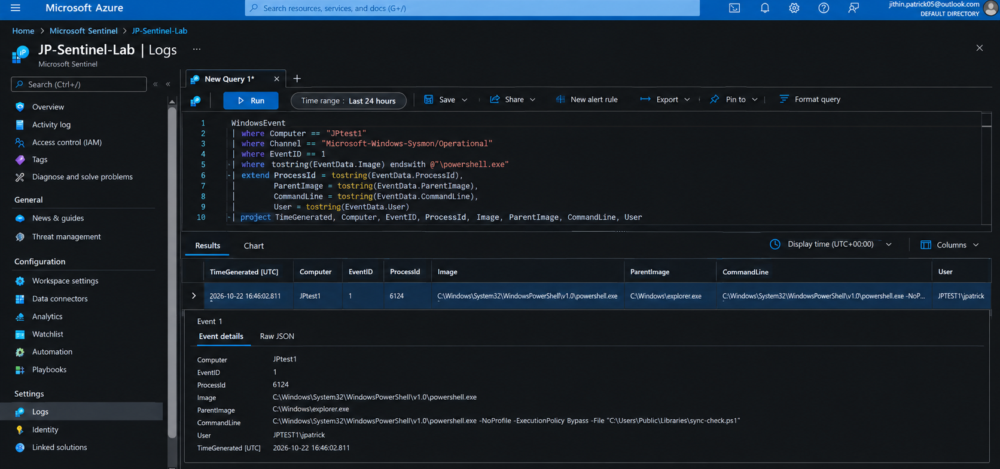
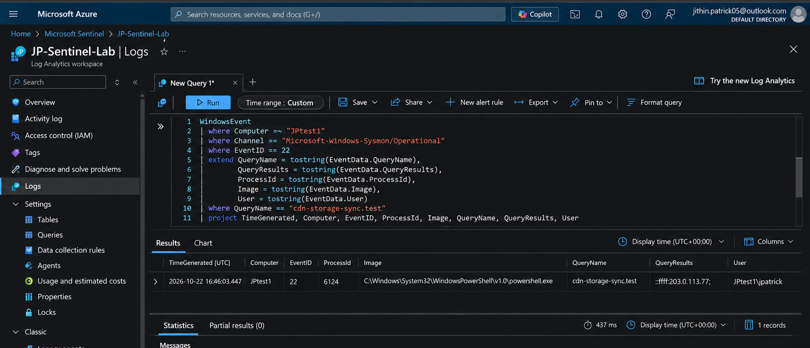
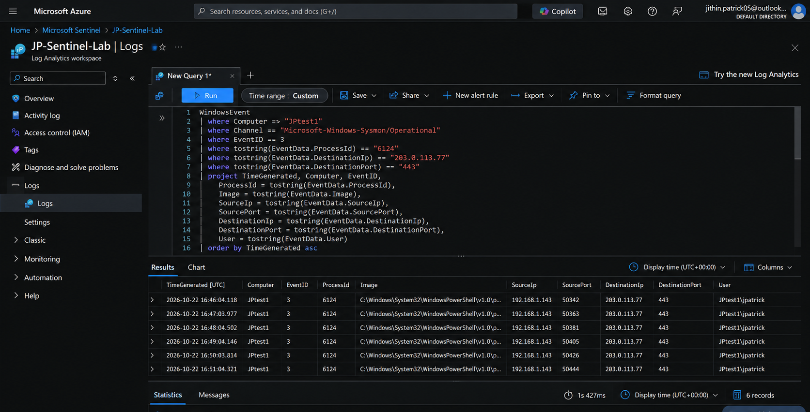
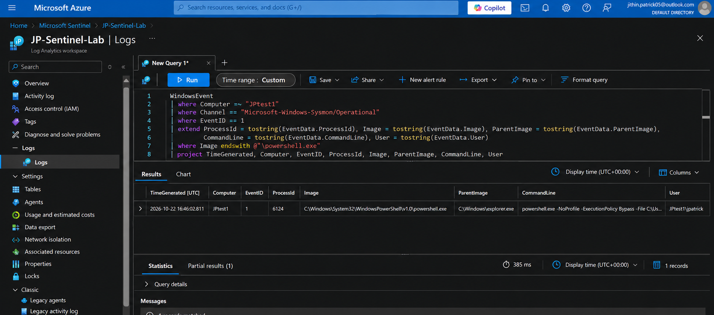

# Microsoft Sentinel KQL Investigation

## Overview

I wanted to take the same JPtest1 activity from the Wireshark and Sysmon labs and see how it looked once the endpoint logs were centralised in Microsoft Sentinel.

The main goal was to answer three questions with KQL:

1. Can I find the PowerShell process that started the activity?
2. Can I tie that process to the DNS lookup seen earlier?
3. Can I confirm the repeated outbound connections from the same process?

The Sysmon Operational log was collected into the `WindowsEvent` table in Log Analytics. I then used the values from the earlier investigation as pivots instead of searching the whole dataset blindly.

## Environment

| Item | Value |
|---|---|
| Workspace | JP-Sentinel-Lab |
| Host | JPtest1 |
| Host IP | 192.168.1.143 |
| User | JPtest1\\jpatrick |
| Log table | WindowsEvent |
| Channel | Microsoft-Windows-Sysmon/Operational |
| Process | powershell.exe |
| Process ID | 6124 |
| DNS name | cdn-storage-sync.test |
| Destination | 203.0.113.77:443 |
| Display time | UTC |

This lab follows directly from:

- [01 - Wireshark Traffic Analysis](../01-wireshark-traffic-analysis/)
- [02 - Windows Endpoint Investigation](../02-windows-endpoint-investigation/)

## Starting point

The previous labs had already identified this sequence:

~~~text
powershell.exe PID 6124
        |
        +-- DNS: cdn-storage-sync.test
        |
        +-- 203.0.113.77:443
        |
        +-- repeated connections at roughly 60-second intervals
~~~

Instead of starting with a broad Sentinel search, I used the hostname, process ID and destination IP as investigation pivots.

---

## 1. PowerShell process creation

I first searched Sysmon Event ID 1 on JPtest1 and filtered for PowerShell.

~~~kusto
WindowsEvent
| where Computer =~ "JPtest1"
| where Channel == "Microsoft-Windows-Sysmon/Operational"
| where EventID == 1
| extend ProcessId = tostring(EventData.ProcessId),
         ParentImage = tostring(EventData.ParentImage),
         CommandLine = tostring(EventData.CommandLine),
         User = tostring(EventData.User)
| where tostring(EventData.Image) endswith @"\powershell.exe"
| project TimeGenerated, Computer, EventID, ProcessId,
          Image = tostring(EventData.Image),
          ParentImage, CommandLine, User
~~~

### Result

| Field | Value |
|---|---|
| TimeGenerated | 2026-10-22 16:46:02.811 UTC |
| Computer | JPtest1 |
| EventID | 1 |
| ProcessId | 6124 |
| Image | C:\\Windows\\System32\\WindowsPowerShell\\v1.0\\powershell.exe |
| ParentImage | C:\\Windows\\explorer.exe |
| User | JPTEST1\\jpatrick |
| CommandLine | powershell.exe -NoProfile -ExecutionPolicy Bypass -File "C:\\Users\\Public\\Libraries\\sync-check.ps1" |

This matched the process event from the endpoint investigation. The important part was not just seeing PowerShell. The PID, parent process, command line and timestamp all matched the earlier Sysmon timeline.

### Evidence

---

## 2. DNS query

The next query looked for Event ID 22 and the hostname already identified during the network investigation.

~~~kusto
WindowsEvent
| where Computer =~ "JPtest1"
| where Channel == "Microsoft-Windows-Sysmon/Operational"
| where EventID == 22
| extend QueryName = tostring(EventData.QueryName),
         QueryResults = tostring(EventData.QueryResults),
         ProcessId = tostring(EventData.ProcessId),
         Image = tostring(EventData.Image),
         User = tostring(EventData.User)
| where QueryName == "cdn-storage-sync.test"
| project TimeGenerated, Computer, EventID, ProcessId,
          Image, QueryName, QueryResults, User
~~~

### Result

| Field | Value |
|---|---|
| TimeGenerated | 2026-10-22 16:46:03.447 UTC |
| Computer | JPtest1 |
| EventID | 22 |
| ProcessId | 6124 |
| Image | powershell.exe |
| QueryName | cdn-storage-sync.test |
| QueryResults | ::ffff:203.0.113.77; |
| User | JPtest1\\jpatrick |

The DNS event appeared **636 ms after the PowerShell process creation**.

The same PID, `6124`, made the query. That gave me a clean link between the process and the hostname that had already appeared in Wireshark.

### Evidence

---

## 3. Outbound network connections

I then filtered Event ID 3 by the same PID, destination and port.

~~~kusto
WindowsEvent
| where Computer =~ "JPtest1"
| where Channel == "Microsoft-Windows-Sysmon/Operational"
| where EventID == 3
| where tostring(EventData.ProcessId) == "6124"
| where tostring(EventData.DestinationIp) == "203.0.113.77"
| where tostring(EventData.DestinationPort) == "443"
| project TimeGenerated, Computer, EventID,
          ProcessId = tostring(EventData.ProcessId),
          Image = tostring(EventData.Image),
          SourceIp = tostring(EventData.SourceIp),
          SourcePort = tostring(EventData.SourcePort),
          DestinationIp = tostring(EventData.DestinationIp),
          DestinationPort = tostring(EventData.DestinationPort),
          User = tostring(EventData.User)
| order by TimeGenerated asc
~~~

### Results

| TimeGenerated UTC | Source IP | Source Port | Destination | PID |
|---|---|---:|---|---:|
| 16:46:04.118 | 192.168.1.143 | 50342 | 203.0.113.77:443 | 6124 |
| 16:47:03.977 | 192.168.1.143 | 50363 | 203.0.113.77:443 | 6124 |
| 16:48:04.502 | 192.168.1.143 | 50381 | 203.0.113.77:443 | 6124 |
| 16:49:04.146 | 192.168.1.143 | 50405 | 203.0.113.77:443 | 6124 |
| 16:50:03.814 | 192.168.1.143 | 50426 | 203.0.113.77:443 | 6124 |
| 16:51:04.321 | 192.168.1.143 | 50444 | 203.0.113.77:443 | 6124 |

All six events were attributed to the same PowerShell process.

The intervals were:

~~~text
59.859 s
60.525 s
59.644 s
59.668 s
60.507 s
~~~

Average interval: **60.04 seconds**

This is the same connection pattern seen in Wireshark, but Sentinel made it easy to search and reproduce from centralised endpoint logs.

### Evidence

---

## 4. Process query view

I kept a separate screenshot of the Event ID 1 query without the expanded event pane because it shows the query and returned columns more clearly.

---

## Connection summary query

After confirming the six individual records, I reduced them into a quick summary.

~~~kusto
WindowsEvent
| where Computer =~ "JPtest1"
| where Channel == "Microsoft-Windows-Sysmon/Operational"
| where EventID == 3
| extend ProcessId = tostring(EventData.ProcessId),
         Image = tostring(EventData.Image),
         SourcePort = tostring(EventData.SourcePort),
         DestinationIp = tostring(EventData.DestinationIp),
         DestinationPort = tostring(EventData.DestinationPort)
| where ProcessId == "6124"
| where DestinationIp == "203.0.113.77"
| where DestinationPort == "443"
| summarize
    ConnectionCount = count(),
    FirstSeen = min(TimeGenerated),
    LastSeen = max(TimeGenerated),
    SourcePorts = make_set(SourcePort)
    by Computer, ProcessId, Image, DestinationIp, DestinationPort
~~~

Expected result from the captured events:

| ConnectionCount | FirstSeen UTC | LastSeen UTC | Destination |
|---:|---|---|---|
| 6 | 16:46:04.118 | 16:51:04.321 | 203.0.113.77:443 |

## Correlation

The three Sentinel searches produced one consistent chain:

~~~text
16:46:02.811  Event ID 1
PowerShell PID 6124 starts
        |
        v
16:46:03.447  Event ID 22
cdn-storage-sync.test -> 203.0.113.77
        |
        v
16:46:04.118  Event ID 3
First connection to 203.0.113.77:443
        |
        v
16:47 - 16:51
Five more connections from PID 6124
~~~

The first network connection occurred **671 ms after the DNS query**.

## Findings

- Sentinel returned the same PowerShell PID identified in the endpoint lab.
- The process was launched by `explorer.exe` under `JPtest1\\jpatrick`.
- The process queried `cdn-storage-sync.test`.
- The query resolved to `203.0.113.77`.
- The same PID generated six TCP/443 connections to that destination.
- The source ports and timestamps matched the Wireshark investigation.
- The six connections averaged approximately 60.04 seconds apart.

## Assessment

The value of Sentinel in this lab was centralisation and repeatability.

In Event Viewer I could investigate one host directly. In Sentinel I could express the same pivots as KQL and quickly reproduce the chain from process creation to DNS and network activity.

If the same pattern appeared in a larger environment, the next step would be to run the same queries across all hosts instead of only JPtest1.

## Detection idea

A useful hunting rule from this lab would look for scripting processes that repeatedly connect to the same external destination over a short period.

I would not alert on `powershell.exe` by itself. Legitimate administration uses PowerShell heavily. The higher-value signal is the combination of:

- PowerShell process context
- uncommon DNS name
- repeated outbound TCP/443 activity
- consistent timing
- the same ProcessId across the sequence

## MITRE ATT&CK

| Activity | Technique | ID |
|---|---|---|
| PowerShell execution | Command and Scripting Interpreter: PowerShell | T1059.001 |
| HTTPS communication | Application Layer Protocol: Web Protocols | T1071.001 |
| DNS communication | Application Layer Protocol: DNS | T1071.004 |

## What I learned

- KQL makes it easier to pivot between process, DNS and network telemetry without manually stepping through each event.
- Keeping the original PID and timestamps from the endpoint investigation made correlation much easier.
- `WindowsEvent` stores useful Sysmon fields inside `EventData`, so extracting only the fields I needed made the result tables easier to work with.
- A narrow query based on known pivots is often more useful during triage than starting with a very broad search.
- Sentinel did not change the underlying evidence; it made the same evidence much easier to search, compare and reuse for detection.

## Scope

This Sentinel evidence set covers Sysmon Event IDs **1, 3 and 22**. File creation and registry persistence from the previous endpoint lab were not used as evidence in this Sentinel write-up.
